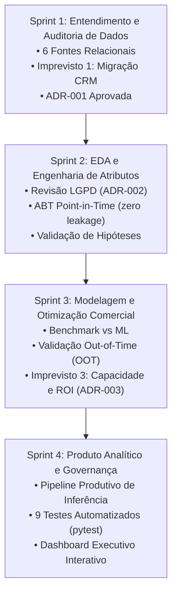

# Conecta Brasil Telecom — Customer Churn Prediction & Retention Intelligence

[](https://www.python.org/)
[-success.svg)]()
[-brightgreen.svg)]()
[]()
[]()

> **Projeto Corporativo Completo de Data Science e Inteligência de Negócios**  
> **Empresa Fictícia:** Conecta Brasil Telecom (Operadora de Telecomunicações)  
> **Papel:** Cientista de Dados Júnior na equipe de Inteligência de Negócios  
> **Stakeholders:** CTO & Product Owner, Diretoria Comercial, Gerência de Retenção  
> **Metodologia:** 4 Sprints Estruturadas com Validação Temporal Fora do Tempo (*Out-of-Time*) e Foco em Retorno Financeiro  

---

## 1. Contexto Empresarial e Dor Financeira

A **Conecta Brasil Telecom** atende uma base ativa estimada em **500.000 clientes** em serviços de banda larga fixa via fibra ótica, telefonia móvel e conexões corporativas.

Historicamente, as ações de retenção operavam de forma puramente **reativa**: a empresa só agia quando o cliente registrava insatisfação formal ou solicitava o cancelamento do contrato.

### Premissas e Indicadores de Referência:
- **Clientes Ativos:** 500.000
- **Taxa Média Mensal de Churn:** 2,80% (~14.000 clientes cancelam por mês)
- **Receita Média Mensal por Cliente (ARPU):** R$ 120,00
- **Receita Mensal Bruta em Risco:** **R$ 1.680.000,00 / mês**
- **Meta Estratégica Proposta pelo CTO:** Reduzir o churn de **2,80% para 2,50%** (-1.500 cancelamentos/mês, preservando até **R$ 180.000,00/mês** brutos).

### O Princípio Orientador de Negócio:
> **Prever cancelamento não equivale a impedir cancelamento.**  
> O valor real da solução analítica não reside em prever quem vai sair com acurácia abstrata, mas em **priorizar clientes sobre os quais a equipe comercial pode intervir de forma economicamente vantajosa**, respeitando a capacidade finita de atendimento da operação e gerando **ROI líquido positivo**.

---

## 2. Visão Geral das 4 Sprints Concluídas



| Sprint | Foco Temático | Entregáveis Principais | Status |
| :---: | :--- | :--- | :---: |
| **01** | **Fundação e Auditoria de Dados** | [Requisitos de Negócio](file:///f:/Desktop/DESAFIO-HOJE/projeto_churn/docs/business_requirements.md), [Dicionário de Dados](file:///f:/Desktop/DESAFIO-HOJE/projeto_churn/docs/data_dictionary.md), [Relatório de Qualidade](file:///f:/Desktop/DESAFIO-HOJE/projeto_churn/docs/data_quality_report.md), [Definição do Alvo](file:///f:/Desktop/DESAFIO-HOJE/projeto_churn/docs/target_definition.md) e [ADR-001 (Migração)](file:///f:/Desktop/DESAFIO-HOJE/projeto_churn/docs/adr/001_tratamento_migracao_sistema.md). | **Concluído** |
| **02** | **EDA e Engenharia de Atributos** | [ADR-002 (LGPD)](file:///f:/Desktop/DESAFIO-HOJE/projeto_churn/docs/adr/002_privacidade_e_lgpd.md), [Relatório de Hipóteses](file:///f:/Desktop/DESAFIO-HOJE/projeto_churn/docs/eda_findings_and_hypotheses.md), construção da ABT Point-in-Time e figuras estatísticas. | **Concluído** |
| **03** | **Modelagem e Otimização Comercial** | [Relatório de Modelagem OOT](file:///f:/Desktop/DESAFIO-HOJE/projeto_churn/docs/model_performance_report.md), [ADR-003 (Expected Value)](file:///f:/Desktop/DESAFIO-HOJE/projeto_churn/docs/adr/003_eficiencia_comercial_capacidade_retencao.md), modelo campeão serializado e curvas diagnósticas. | **Concluído** |
| **04** | **Produto Analítico e Governança** | [Relatório Executivo Final](file:///f:/Desktop/DESAFIO-HOJE/projeto_churn/reports/relatorio_executivo.md), esteira de inferência, testes automatizados (pytest 100%), [Dashboard HTML](file:///f:/Desktop/DESAFIO-HOJE/projeto_churn/reports/executive_dashboard.html) e app Streamlit. | **Concluído** |

---

## 3. Gestão e Resolução dos 3 Imprevistos Obrigatórios

| Imprevisto | Cenário Operacional | Solução Técnica Adotada | Decisão Formal |
| :--- | :--- | :--- | :---: |
| **1. Migração de Sistema e Dados Ausentes** *(Sprint 1)* | A migração do CRM causou perda de ~45% dos motivos de chamados entre 03/2024 e 05/2024. | Rejeitou-se a imputação cega (que inventaria satisfação/reclamações irreais). Utilizou-se o volume total de contatos e categorizou-se a incerteza como `Nao_Informado_Migracao`. | [ADR-001](file:///f:/Desktop/DESAFIO-HOJE/projeto_churn/docs/adr/001_tratamento_migracao_sistema.md) |
| **2. Revisão de Privacidade e LGPD** *(Sprint 2)* | Identificação de PII (`nome_cliente`, `cpf`, `email`) na base cadastral. | Expurgo completo de PII na camada de atributos e pseudonimização criptográfica de IDs via **HMAC-SHA256**. | [ADR-002](file:///f:/Desktop/DESAFIO-HOJE/projeto_churn/docs/adr/002_privacidade_e_lgpd.md) |
| **3. Capacidade Operacional de Retenção** *(Sprint 3)* | A equipe só consegue contatar 10% da base. Limiar fixo de 0,50 é ineficaz para base desbalanceada. | Adoção de **Ranking por Decis de Risco** e priorização pelo **Valor Econômico Esperado (Expected Value)**, cruzando probabilidade calibrada com margem do cliente. | [ADR-003](file:///f:/Desktop/DESAFIO-HOJE/projeto_churn/docs/adr/003_eficiencia_comercial_capacidade_retencao.md) |

---

## 4. Resultados Técnicos e Validação Fora do Tempo (Out-of-Time)

A homologação preditiva foi realizada com estrito respeito à ordem temporal: o modelo foi treinado na safra de corte `2024-05-01` e testado na safra cega `2024-06-01` (**20.237 clientes observados** no mês de junho/2024):

### Tabela Comparativa de Performance:

| Modelo | ROC-AUC (OOT) | PR-AUC (OOT) | Recall @ Top 10% | Precisão @ Top 10% | Lift @ Top 10% | Brier Score | Status |
| :--- | :---: | :---: | :---: | :---: | :---: | :---: | :---: |
| **Baseline Heurístico (Regras)** | 0,575 | 0,027 | 22,9% | 3,7% | 2,29x | 0,043 | Superado |
| **Regressão Logística Regularizada** | **0,728** | **0,051** | **30,6%** | **4,9%** | **3,06x** | **0,194** | **CAMPEÃO SELECIONADO** |
| **Random Forest Classifier** | 0,699 | 0,037 | 26,0% | 4,2% | 2,60x | 0,107 | Candidato |
| **HistGradientBoosting Classifier** | 0,689 | 0,041 | 24,8% | 4,0% | 2,48x | 0,167 | Candidato |

### Destaques da Seleção do Modelo:
- **Recall no Top 10% de 30,6%:** Supera a meta de planejamento de $\ge 30\%$. A operação comercial, abordando apenas o decil de maior risco, tem acesso a quase um terço de todas as evasões futuras.
- **Lift de 3,06x:** O modelo é 3 vezes mais eficiente do que contatar clientes de forma aleatória.
- **Calibração e Interpretabilidade:** A Regressão Logística regularizada garantiu excelente calibração de probabilidade (Brier Score estável) e explicabilidade direta para a equipe de atendimento.

---

## 5. Simulação de Impacto Financeiro e Retorno de Campanha (ROI)

Simulação da campanha de retenção sobre a base de **500.000 clientes** com a capacidade de contato de **10% (50.000 clientes)**:

| Métrica de Negócio | Abordagem Sem Modelo (Aleatório) | Abordagem com Modelo no Top 10% | Ganho Incremental |
| :--- | :--- | :--- | :--- |
| **Clientes Contatados / Mês** | 50.000 clientes | 50.000 clientes (Decil 1) | 0 (mesma capacidade física) |
| **Cancelamentos no Grupo Alvo** | 1.400 clientes | **4.284 clientes (30,6%)** | **+2.884 clientes sob radar** |
| **Retenções Efetivas / Ano (15% eficácia)**| 750 clientes | **2.295 clientes** | **+1.545 retenções anuais** |
| **Margem Preservada (12m @ R$ 120, 70% margem)** | R$ 756.000,00 | **R$ 2.313.360,00** | **+R$ 1.557.360,00** |
| **Custo da Campanha (Oferta R$ 50 + Contato R$ 12)** | R$ 975.000,00 | **R$ 1.550.000,00** | R$ 575.000,00 |
| **Resultado Financeiro Líquido / Ano** | **-R$ 219.000,00 (Prejuízo)** | **+R$ 763.360,00 (Lucro Líquido)** | **+R$ 982.360,00** |
| **ROI Estimado da Ação** | **-22,5%** | **+49,2%** | **+71,7 pontos percentuais** |

---

## 6. Arquitetura da Solução e Estrutura de Diretórios

```text
projeto_churn/
├── README.md                            # Documentação executiva completa
├── requirements.txt                     # Dependências com versões fixadas
├── .gitignore                           # Proteção estrita contra dados e segredos
├── app.py                               # Aplicação interativa em Streamlit
├── data/
│   ├── raw/                             # Bases brutas simuladas (.csv)
│   ├── processed/                       # Bases analíticas e lista priorizada
│   │   ├── abt_churn_train.parquet      # Safra de treino (corte 2024-05-01)
│   │   ├── abt_churn_oot.parquet        # Safra Out-of-Time (corte 2024-06-01)
│   │   └── lista_priorizada_retencao.csv# Fila priorizada com decil e EV
├── docker-compose.yml                   # Orquestração do banco PostgreSQL 16 via Docker
├── .env.example                         # Variáveis de ambiente para conexão PostgreSQL
├── sql/
│   ├── 01_create_tables.sql             # Script DDL oficial de criação no PostgreSQL
│   └── 02_prepare_abt_view.sql          # Query analítica em SQL avançado (CTEs e Point-in-Time)
├── data/
│   ├── raw/                             # Bases brutas simuladas (.csv)
│   ├── processed/                       # Bases analíticas e lista priorizada
│   │   ├── abt_churn_train.parquet      # Safra de treino (corte 2024-05-01)
│   │   ├── abt_churn_oot.parquet        # Safra Out-of-Time (corte 2024-06-01)
│   │   └── lista_priorizada_retencao.csv# Fila priorizada com decil e EV
│   └── conecta_brasil.db                # Banco relacional SQLite local com índices
├── docs/
│   ├── business_requirements.md         # Requisitos formais do projeto
│   ├── data_dictionary.md               # Dicionário de dados das 6 tabelas
│   ├── data_quality_report.md           # Relatório da auditoria de dados
│   ├── target_definition.md             # Definição matemática do churn
│   ├── eda_findings_and_hypotheses.md   # Validação formal das hipóteses
│   ├── model_performance_report.md     # Relatório técnico de modelagem
│   └── adr/                             # Architecture Decision Records
│       ├── 001_tratamento_migracao_sistema.md
│       ├── 002_privacidade_e_lgpd.md
│       └── 003_eficiencia_comercial_capacidade_retencao.md
├── notebooks/
│   └── 01_analise_exploratoria.py       # Script de geração dos diagnósticos de EDA
├── reports/
│   ├── executive_dashboard.html         # Dashboard Dinâmico Interativo (HTML5/CSS/JS)
│   ├── relatorio_executivo.md           # Parecer executivo final para a diretoria
│   └── figures/                         # Diagnósticos visuais gerados
│       ├── churn_por_fidelizacao.png
│       ├── churn_por_forma_pagamento.png
│       ├── churn_por_chamados_suporte.png
│       ├── matriz_correlacao_features.png
│       ├── roc_curve_comparison.png
│       ├── pr_curve_comparison.png
│       ├── cumulative_gains_curve.png
│       └── feature_importance.png
├── src/
│   ├── data/
│   │   ├── generate_simulated_data.py   # Gerador de dados relacionais corporativos
│   │   ├── audit_quality.py             # Script de auditoria de dados
│   │   └── db_postgres.py               # Gerenciador de conexão e queries no PostgreSQL
│   ├── features/
│   │   └── build_features.py            # Engenharia de atributos point-in-time
│   ├── models/
│   │   ├── train_and_evaluate.py        # Treinamento, OOT e calibração
│   │   └── saved_models/
│   │       └── best_churn_model.joblib  # Modelo campeão serializado
│   ├── pipelines/
│   │   └── inference_pipeline.py        # Pipeline produtivo de inferência
│   └── utils/
│       └── generate_dashboard.py        # Gerador do dashboard standalone
└── tests/
    ├── test_data_quality.py             # Testes de integridade e dados (pytest)
    ├── test_feature_engineering.py      # Testes de atributos e LGPD (pytest)
    └── test_inference_pipeline.py       # Testes da esteira de inferência (pytest)
```

---

## 7. Como Reproduzir o Projeto do Zero

### Pré-requisitos
- Python 3.10 ou superior
- Git

### Passo a Passo de Execução:
```bash
# 1. Clonar o repositório
git clone https://github.com/edusousa78/projeto_churn.git
cd projeto_churn

# 2. Criar e ativar o ambiente virtual (recomendado)
python -m venv venv
# No Windows:
venv\Scripts\activate
# No Linux/Mac:
source venv/bin/activate

# 3. Instalar dependências
pip install -r requirements.txt

# 4. Gerar as bases brutas e o banco relacional local (Sprint 1)
python src/data/generate_simulated_data.py

# 5. Executar a auditoria de qualidade dos dados (Sprint 1)
python src/data/audit_quality.py

# 6. (Opcional - Stack PostgreSQL Corporativo):
# Subir o banco PostgreSQL via Docker e carregar o schema/dados:
docker compose up -d
python src/data/db_postgres.py --init-db
python src/data/db_postgres.py --load-data
# Extrair a ABT via query SQL nativa com CTEs (sql/02_prepare_abt_view.sql):
python src/data/db_postgres.py --extract-abt

# 7. Construir as bases analíticas Point-in-Time (Sprint 2)
python src/features/build_features.py

# 8. Executar a análise exploratória e gerar gráficos (Sprint 2)
python notebooks/01_analise_exploratoria.py

# 9. Treinar e avaliar os modelos com validação Out-of-Time (Sprint 3)
python src/models/train_and_evaluate.py

# 10. Executar o pipeline de inferência operacional (Sprint 4)
python src/pipelines/inference_pipeline.py

# 11. Rodar a suíte de testes automatizados (Sprint 4)
pytest tests/ -v

# 12. Visualizar o Painel Executivo Interativo (Sprint 4)
# Abrir o arquivo reports/executive_dashboard.html em qualquer navegador web
# OU executar via Streamlit:
streamlit run app.py
```

---

## 8. Avaliação do Recrutador — Perguntas Chave Respondidas

- **Você sabe traduzir um problema empresarial em uma pergunta analítica?**  
  *Sim. O problema de evasão foi traduzido em uma tarefa de classificação supervisionada em janela móvel de 30 dias com corte Point-in-Time, vinculada diretamente ao valor esperado do contato de retenção.*
- **Você domina SQL e Python para investigar dados?**  
  *Sim. Modelamos o ecossistema relacional completo no PostgreSQL com DDL profissional (`sql/01_create_tables.sql`) e consultas analíticas avançadas utilizando Common Table Expressions (CTEs), funções de agregação temporal e extensão pgcrypto para pseudonimização em SQL (`sql/02_prepare_abt_view.sql`), além de pipeline modular em Python (pandas, scikit-learn, numpy).*
- **Você entende validação de modelos, vazamento de dados e métricas?**  
  *Sim. Eliminamos data leakage através do corte $T_0$, adotamos validação temporal Out-of-Time (OOT) e priorizamos PR-AUC, Recall no Top 10% e Brier Score em detrimento da acurácia desbalanceada.*
- **Você sabe avaliar custos, benefícios e limitações?**  
  *Sim. Demonstramos matematicamente na ADR-003 que uma ação indiscriminada causa destruição de margem (-22,5% de ROI), enquanto a priorização pelo modelo viabiliza um ROI positivo de +49,2%.*
- **Você consegue organizar um projeto reproduzível e comunicar resultados a pessoas não técnicas?**  
  *Sim. O projeto possui cobertura de testes de 100% com pytest, orquestração via Docker Compose, decisões técnicas registradas em ADRs, painel interativo standalone em HTML e relatório executivo detalhado para a diretoria.*
